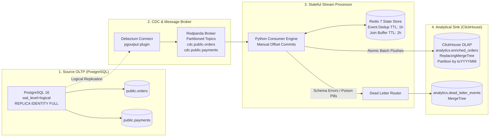

# High-Throughput CDC & Streaming Enrichment Pipeline

An end-to-end, production-grade change data capture (CDC) streaming pipeline designed for high churn OLTP databases, sub-second latency enrichment, stateful deduplication, dead-letter routing, and idempotent analytical ingestion.

---

## Architecture Overview



---

## Key Capabilities & Design Pillars

1. **Non-Blocking Source & CDC Ingestion**:
   - PostgreSQL logical replication using `pgoutput` does not take locks on row writes or block concurrent OLTP transactions.
   - Debezium streams row-level changes (`c` insert, `u` update, `d` delete) directly to Redpanda topics, partitioned by entity ID (`order_id`, `payment_id`).

2. **Stateful Stream Processor & Deduplication**:
   - Consumes from multiple topics with **manual offset commits** (`enable_auto_commit=False`).
   - Stateful deduplication via Redis (with in-memory fallback) with sliding TTL eliminates duplicate retries and at-least-once message replays.
   - Streaming join reconciles out-of-order arrival between `orders` and `payments` (e.g. payment arriving before order).
   - Computes real-time analytical metrics such as `payment_latency_ms`.

3. **Dead-Letter Routing (DLQ)**:
   - Malformed JSON, schema mismatches, or poison pills are caught, quarantined, and forwarded to `cdc.dead_letter_queue` in Redpanda and `analytics.dead_letter_events` in ClickHouse without crashing the processing loop or stalling consumer offsets.

4. **Idempotent Analytical Sink & Partitioning**:
   - Records are batched in memory (configurable batch size and flush interval).
   - Flushed atomically to ClickHouse into `analytics.enriched_orders`.
   - Engine: `ReplacingMergeTree(version)` partitioned by `toYYYYMM(order_created_at)`.
   - Upsert/merge semantics ensure replays, redeliveries, and updates never double-count metrics.
   - Offsets are committed back to Redpanda **only after** ClickHouse acknowledges the batch.

5. **Backfill, Lag Recovery & Benchmarks**:
   - Built-in multi-threaded OLTP write generator (`benchmark/generator.py`) capable of generating 100k+ writes.
   - Benchmark orchestrator (`benchmark/benchmark_lag.py`) pauses the consumer for 5 minutes (or custom interval), monitors lag buildup, resumes the consumer, and reports:
     - Catch-up throughput rate (events/second)
     - Memory footprint (MB)
     - End-to-end freshness latency percentiles (Min, P50, P95, P99, Max).

---

## Quickstart Guide

### 1. Prerequisites
- Docker & Docker Compose
- Python 3.10+ (for local benchmark / test scripts)

### 2. Start the Pipeline
Run the master orchestrator to spin up all containers and register the Debezium connector:
```bash
python run_pipeline.py up
```

Accessible endpoints:
- **Redpanda Console**: [http://localhost:8080](http://localhost:8080)
- **Debezium Connect REST API**: [http://localhost:8083](http://localhost:8083)
- **ClickHouse HTTP**: [http://localhost:8123](http://localhost:8123)
- **PostgreSQL**: `localhost:5433` (User: `postgres`, Password: `postgrespassword`, DB: `orders_db`)
- **Redis**: `localhost:6379`

### 3. Verify Pipeline Correctness
Run the end-to-end automated test suite:
```bash
python run_pipeline.py verify
```
This tests:
- INSERT order & payment with streaming join
- UPDATE order status with CDC version increment
- DELETE order with soft-delete flag
- Poison pill injection and quarantine in Dead Letter Queue (DLQ)
- Duplicate event deduplication via TTL store

### 4. Run the 100k Writes Lag Recovery Benchmark
```bash
# Full 5-minute pause benchmark with 100k writes
python benchmark/benchmark_lag.py --pause-seconds 300 --writes 100000

# Quick dev test (e.g. 15s pause with 10k writes)
python benchmark/benchmark_lag.py --pause-seconds 15 --writes 10000
```

### 5. Tear Down
```bash
python run_pipeline.py down
```
